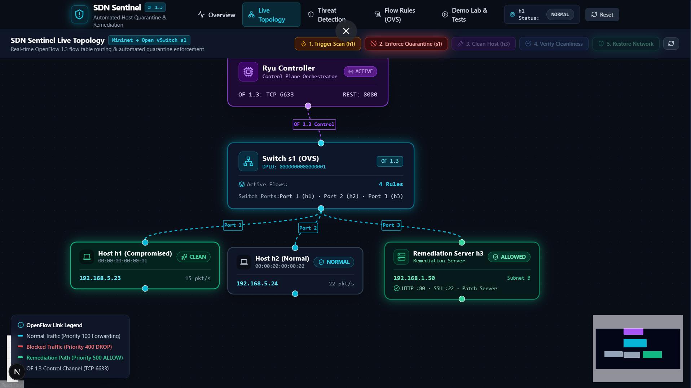

<p align="center">
  
</p>

<h1 align="center">SDN Sentinel</h1>

<p align="center">
  <strong>Detect suspicious activity. Quarantine a host. Keep remediation available.</strong><br>
  A Software Defined Networking project using Mininet, Open vSwitch, Ryu, FastAPI, and Next.js.
</p>

<p align="center">
  <a href="#overview">Overview</a> ·
  <a href="#network-topology">Topology</a> ·
  <a href="#run-the-project">Run</a> ·
  <a href="#demo-walkthrough">Demo</a> ·
  <a href="#api-and-exploration">Explore</a>
</p>

> **Screenshot note:** the dashboard image is an overview of the topology. This WSL setup runs Ryu's REST API on port **8081** because another process on the machine already uses port 8080.

## Overview

**SDN Sentinel** demonstrates an SDN security response lifecycle. A simulated flow-rate alert identifies host **h1** as suspicious. The backend asks the Ryu controller to install OpenFlow rules on switch **s1**. Those rules isolate h1, allow communication with remediation host **h3**, and can later be removed to restore normal forwarding.

The project combines a real Mininet/Open vSwitch topology and Ryu controller with a FastAPI orchestration backend and a Next.js dashboard. The demo's scan event is simulated by the application; it is not an always-on intrusion detection sensor. Use Mininet pings to check real data-plane connectivity.

### What you can demonstrate

- View network state and incidents in a live dashboard.
- Inspect the Mininet topology and OpenFlow flow table.
- Simulate suspicious new-flow activity from h1.
- Apply high-priority quarantine rules tagged with cookie `0x9000`.
- Preserve the remediation path between h1 and h3.
- Verify connectivity, then remove quarantine rules and restore forwarding.

## Network topology

This is a **single-switch, three-host star topology**. Each host connects directly to the Open vSwitch. Ryu controls the switch over OpenFlow 1.3.

```text
                  Ryu controller c0
                 OpenFlow 1.3 : 6633
                         |
                         |
                    Open vSwitch s1
                   /       |       \
                  /        |        \
          h1 (infected)  h2 (normal)  h3 (remediation)
          192.168.5.23   192.168.5.24 192.168.1.50
```

| Component | Address / port | Role |
|---|---|---|
| h1 | `192.168.5.23` | Host used for the simulated suspicious activity |
| h2 | `192.168.5.24` | Normal host used to check lateral connectivity |
| h3 | `192.168.1.50` | Remediation server allowed during quarantine |
| s1 | DPID `1` | Open vSwitch forwarding traffic under Ryu control |
| c0 | OpenFlow TCP `6633` | Ryu controller connection |
| Ryu REST API | `8081` | Flow statistics and Sentinel controller actions |
| Backend API | `8000` | FastAPI orchestration and WebSocket events |
| Dashboard | `3000` | Next.js web interface |

The Ryu REST port is set to `8081` for this setup because Java is listening on `8080`. The backend reads the Ryu API address from `RYU_API_URL`.

## Project structure

```text
.
├── backend/          FastAPI routes and quarantine state manager
├── controller/       Ryu OpenFlow 1.3 controller and flow helpers
├── frontend/         Next.js dashboard
├── network/          Mininet topology and Ubuntu setup helper
├── cli_demo.py       Interactive terminal demonstration
├── run.txt           Startup, exploration, and shutdown commands
├── presentation.txt  Presenter speech and demo cues
└── image.png         Dashboard topology screenshot
```

## Requirements

- Windows 10/11 with WSL2 and Ubuntu 22.04
- Node.js and npm for the dashboard
- Mininet and Open vSwitch installed inside Ubuntu
- Ryu, FastAPI, Uvicorn, and Requests installed in the Ubuntu Python environment

### Ubuntu packages

Run inside Ubuntu:

```bash
sudo apt update
sudo apt install -y mininet openvswitch-switch python3-pip python3-venv
sudo service openvswitch-switch start
```

The project directory in the commands below is on the Windows `D:` drive, mounted in WSL at `/mnt/d`.

### Python environment

The working setup uses an environment in Ubuntu's Linux filesystem:

```bash
python3 -m venv ~/sdn-venv
source ~/sdn-venv/bin/activate
python -m pip install --upgrade pip setuptools wheel
python -m pip install ryu fastapi uvicorn requests
```

**Ryu 4.34 compatibility:** Ryu 4.34's PyPI release expects an older Eventlet API. In the tested Ubuntu 22.04 / Python 3.10 environment, use a current Eventlet and dnspython, then apply this one-time adjustment to the Ryu file in the virtual environment:

```bash
python -m pip install "eventlet==0.41.3" "dnspython>=2,<3"
python - <<'PY'
from pathlib import Path

path = Path.home() / "sdn-venv/lib/python3.10/site-packages/ryu/app/wsgi.py"
source = path.read_text()
old = "    from eventlet.wsgi import ALREADY_HANDLED"
new = '''    import eventlet.wsgi
    ALREADY_HANDLED = getattr(
        getattr(eventlet.wsgi, "WSGI_LOCAL", None),
        "already_handled",
        getattr(eventlet.wsgi, "ALREADY_HANDLED", None),
    )'''
if old not in source:
    raise SystemExit(f"Expected Ryu import line not found in {path}")
path.write_text(source.replace(old, new, 1))
print("Applied Ryu/Eventlet compatibility adjustment")
PY
ryu-manager --version
```

This changes the installed Ryu package inside `~/sdn-venv`; it does not modify the project source. The Eventlet deprecation warning when Ryu starts is informational.

### Frontend packages

From Windows PowerShell at the project root:

```powershell
npm.cmd --prefix frontend install
```

## Run the project

Start each service in its own terminal and leave all terminals running.

### Terminal 1 — Ryu controller (Ubuntu)

```bash
cd "/mnt/d/SEMESTER - 7/Software Defined Networks/SDN Networking Project/controller"
source ~/sdn-venv/bin/activate
ryu-manager --verbose --wsapi-port 8081 sdn_controller.py ryu.app.ofctl_rest
```

### Terminal 2 — Mininet network (Ubuntu)

```bash
cd "/mnt/d/SEMESTER - 7/Software Defined Networks/SDN Networking Project/network"
sudo mn -c
sudo python3 topology.py
```

When the topology is ready, Mininet displays the `mininet>` prompt. Keep this terminal open.

### Terminal 3 — Backend API (Ubuntu)

```bash
cd "/mnt/d/SEMESTER - 7/Software Defined Networks/SDN Networking Project/backend"
source ~/sdn-venv/bin/activate
export RYU_API_URL=http://127.0.0.1:8081
python -m uvicorn main:app --host 0.0.0.0 --port 8000
```

### Dashboard (Windows PowerShell)

If the dashboard is not already running, open PowerShell at the project root:

```powershell
npm.cmd run dev
```

Open **[http://localhost:3000](http://localhost:3000)**.

### Confirm the services

From another Ubuntu terminal:

```bash
curl http://127.0.0.1:8081/stats/switches
curl http://127.0.0.1:8000/api/health
```

After Mininet connects, Ryu should return `[1]`. The backend health endpoint should return JSON with `"status":"healthy"`.

## Dashboard tour

| Page | What it shows |
|---|---|
| **Overview** | Current host state, topology summary, active flow counts, and recent incidents |
| **Live Topology** | Visual map of the controller, switch, hosts, links, and current demo state |
| **Threat Detection** | Simulated flow spike alerts and incident history |
| **Flow Rules (OVS)** | Flow entries, priorities, matches, actions, and cookie filters |
| **Demo Lab & Tests** | Six-step quarantine lifecycle and an application-level verification matrix |

## Demo walkthrough

Open **Demo Lab & Tests** and run the six stages in order:

1. **Baseline Ping** — reset to the normal state and view baseline verification.
2. **Trigger Scan** — simulate 148 new flows from h1 in five seconds. The configured threshold is 100.
3. **Auto-Quarantine** — ask Ryu to install high-priority quarantine rules tagged with cookie `0x9000`.
4. **Prove Isolation** — view the expected allow/block results in the dashboard matrix.
5. **Clean & Verify** — represent remediation through h3 and verify the host before release.
6. **Restore Network** — remove the quarantine rules and return the host to normal forwarding.

The scan and dashboard verification matrix are simulated by the application. To demonstrate actual data-plane behavior, use the Mininet commands below while the network is running.

## API and exploration

Interactive backend documentation is available at **[http://localhost:8000/docs](http://localhost:8000/docs)**.

Useful endpoints:

```text
GET  /api/health
GET  /api/topology
GET  /api/flows
GET  /api/incidents
POST /api/incidents/trigger-scan
POST /api/quarantine
POST /api/quarantine/remediation-step
POST /api/quarantine/release
POST /api/quarantine/reset
POST /api/verification/run
GET  /stats/switches                 (Ryu REST API on port 8081)
GET  /stats/flow/1                   (Ryu REST API on port 8081)
```

At Mininet's `mininet>` prompt:

```text
nodes
net
links
dump
pingall
h1 ping -c 3 192.168.5.24
h1 ping -c 3 192.168.1.50
h2 ping -c 3 192.168.1.50
sh ovs-ofctl -O OpenFlow13 dump-flows s1
```

`net` shows the single-switch, three-host star: `h1-eth0:s1-eth1`, `h2-eth0:s1-eth2`, and `h3-eth0:s1-eth3`. During quarantine, h1-to-h2 should be blocked while h1-to-h3 remediation remains allowed. After restoration, h1-to-h2 should work again.

For a terminal-driven menu, from the project root in Ubuntu run:

```bash
source ~/sdn-venv/bin/activate
python cli_demo.py
```

The interactive menu includes topology and flow views, connectivity verification, scan trigger, quarantine, cleanup, restore, and reset. Use either the CLI demo or dashboard demo at a time because both change the same backend state.

## Troubleshooting

- **Port 8080 is already occupied:** keep the other service running. Start Ryu with `--wsapi-port 8081` and set `RYU_API_URL=http://127.0.0.1:8081` in the backend terminal.
- **Ryu does not see the switch:** confirm Ryu is running, then check the Ryu terminal for a switch connection. The controller and Mininet topology use OpenFlow TCP port 6633.
- **Dashboard cannot reach the API:** confirm the backend is running on port 8000 and open `http://localhost:8000/api/health`.
- **Need the complete terminal checklist or presenter script:** see [run.txt](run.txt) and [presentation.txt](presentation.txt).

## Shutdown

- At `mininet>`, type `exit`.
- Press `Ctrl+C` in the Ryu and backend terminals.
- Press `Ctrl+C` in the PowerShell terminal running the frontend.
